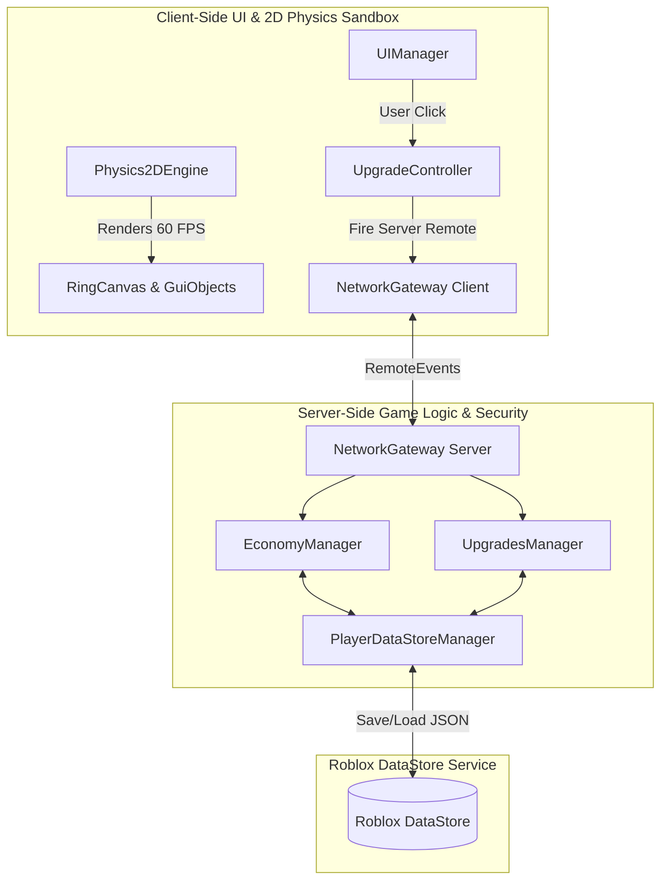
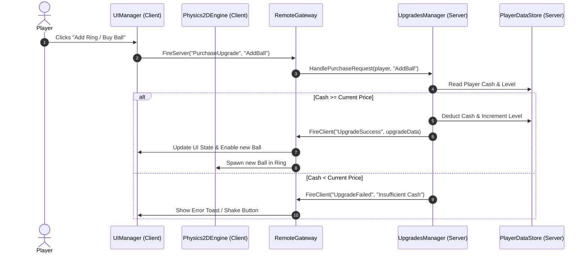

CONSUMED-BY: Gate 0 / Matrix A
STATUS: LIVING — amend on divergence; every amendment cites its triggering fact

# HIGH-LEVEL DESIGN (HLD) — 2D BOUNCY BALL TYCOON

## 1. SYSTEM ARCHITECTURE OVERVIEW

---

## 2. COMPONENT MODULE BREAKDOWN

### C-1: Client Component Modules (`ReplicatedStorage.Source.Client`)
- **`Physics2DEngine.luau`**: Custom lightweight 2D vector physics simulator. Computes ball-to-ring arc collisions, velocity restitution, gravity, ring gap exits, and spike collisions.
- **`RingCanvasController.luau`**: Manages visual rotation of the main pink circular ring UI, rendering the opening gap, and positioning inner balls.
- **`UIManager.luau`**: Controls left upgrade drawer, right menu options, top stats status, and bottom action bar. Handles smooth transitions, animations, and modal windows.
- **`UpgradeController.luau`**: Local predictive UI state for upgrade prices and button interlock states.

### C-2: Server Component Modules (`ServerScriptService.Source.Server`)
- **`EconomyManager.luau`**: Authoritative manager of player Cash and Prestige currency. Validates income rate limits and applies multipliers.
- **`UpgradesManager.luau`**: Handles upgrade purchase requests. Calculates price formulas, verifies affordability, updates player upgrade levels, and broadcasts updates.
- **`PlayerDataStoreManager.luau`**: Manages player session data using session locking (`ProfileService` pattern) to guarantee save integrity and prevent data loss.

### C-3: Shared Component Modules (`ReplicatedStorage.Source.Shared`)
- **`UpgradeDefinitions.luau`**: Config catalog of all upgrades, base costs, growth formulas, max levels, and unlock icons.
- **`BallDefinitions.luau`**: Tier catalog of ball types (Common, Rare, Epic, Legendary), colors, base cash multipliers, and luck spawn odds.
- **`Signal.luau` / `Promise.luau`**: Utility event dispatcher for decoupled component messaging.

---

## 3. DATA FLOW & SYNCHRONIZATION

