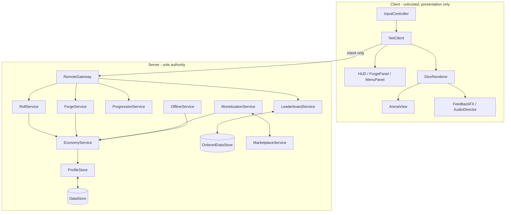

CONSUMED-BY: Gate 0 / Matrix A
STATUS: LIVING — amend on divergence; every amendment cites its triggering fact

# HIGH-LEVEL DESIGN — DICE FORGE INCREMENTAL

## 1. THE AUTHORITY MODEL (read this before anything else)

**The server decides every roll outcome by weighted sampling. The client's 3D rigid-body tumble is animation that resolves to an already-decided face, and is never read to determine anything.**

The sequence is: client sends `Roll` (intent, no payload) → server samples each die's face from its mass distribution → server computes payout, applies elements and streak, credits Cash → server pushes `RollResult` naming the faces → client animates dice that land on exactly those faces.

**Why it must be this way.** Roblox assigns network ownership of moving parts to a client by default. Dice are moving parts. If the physical resting position determined the payout, an exploiter could rotate a die to show any face and mint currency at will — and with public leaderboards, that is not a hypothetical. Deciding first and animating second makes the entire class of physics manipulation economically inert (threat T-2).

**What the server does NOT hold.** No rigid-body state, no die positions, velocities, orientations, or collisions. Per-player cost is a handful of floats and one sample per die per roll.

**The constraint this imposes on features.** Because no physical state exists server-side, **no game feature may depend on where a die is, what it hit, or how it moved.** Every element, bonus and interaction must be resolvable from the *resolved face set* alone. A proposed feature that cannot be is rejected at design time rather than implemented — the only ways to build it are per-die server physics (breaking NFR-2) or client economic authority (breaking NFR-5 and reopening T-1). *(This is the failure class recorded as ledger L-015.)*

**What stays real for the player.** The odds genuinely follow the mass they forged: `P(face i) ∝ (M − mᵢ)`. Heavy faces really do land face-down more often. The player's mental model is entirely correct — it is arithmetic rather than collision solving, and this is recorded openly as accepted risk R-1 rather than concealed.

---

## 2. TOPOLOGY

Every inbound arrow passes through `RemoteGateway`. There is exactly one door.

---

## 3. MODULES

### C-1 Server (`ServerScriptService.Server`)
- **`ServerBootstrap`** — constructs services in dependency order, wires player lifecycle, starts the tick, registers `BindToClose`.
- **`RemoteGateway`** — the sole inbound boundary. Rate-limits, then validates, then dispatches. No other module exposes a remote.
- **`RollService`** — samples faces from mass distributions, resolves elements across the throw, applies streak state. The core loop.
- **`ForgeService`** — validates and applies mass redistribution proposals as closed systems; applies element assignment and shape changes.
- **`EconomyService`** — the only module permitted to mutate Cash, Gems, or Diamonds. Single chokepoint by design, so the audit surface is one file.
- **`ProgressionService`** — quests, login streak, playtime chests, daily spin, codes, group rewards.
- **`AscensionService`** — prestige reset and Diamond tree purchases.
- **`OfflineService`** — rolling income-rate average, vault accrual, atomic claim.
- **`MonetizationService`** — the single `ProcessReceipt` assignment and all gamepass entitlement checks.
- **`LeaderboardService`** — log-scaled publication and cached retrieval.
- **`PlayerProfile`** — the **sole** wrapper over the persistence library (see §5). Owns the profile blueprint, the migration chain, the payload ceiling, and the release/reconcile lifecycle. Named `PlayerProfile` rather than `ProfileStore` deliberately, to avoid collision with loleris's library of that name. **No other module calls the persistence library directly**, so swapping the library is a one-module change.
- **`RateLimiter`** — per-player per-remote token buckets.

### C-2 Shared (`ReplicatedStorage.Shared`)
Pure data and pure functions. No state, no authority, no side effects — safe to replicate because knowing them grants no power.
- **`ForgeMath`** — `landingProbabilities(mass)`, `faceValue(mass)`, `expectedValue(mass)`, `voidProbability(mass)`. The client uses these for the forge preview (FR-3.4); the server uses them for truth. **Shared so both sides agree exactly.**
- **`DiceCatalog`** — shape definitions, face counts, mass floors, budget caps.
- **`ElementCatalog`** — element definitions and their mass-coupled payoff functions.
- **`UpgradeCatalog`** — Cash and Diamond upgrade definitions and cost curves.
- **`Remotes`** — the single canonical remote-name registry.
- **`Format`** — suffix-ladder number formatting, precision-safe to 1e300.

### C-3 Client (`StarterPlayer.StarterPlayerScripts.Client`)
- **`ClientBootstrap`**, **`NetClient`** (sole outbound wrapper), **`ArenaView`**, **`DiceRenderer`** (tumble-to-target animation, instance pooling), **`ForgePanel`** (live preview via `ForgeMath`), **`HUD`**, **`MenuPanel`**, **`FeedbackFX`**, **`AudioDirector`**.

---

## 4. KEY FLOWS

### 4.1 A roll
1. Client fires `Roll` — no payload.
2. `RemoteGateway` rate-limits against the player's server-known auto-roll tier (T-3).
3. `RollService` samples each die: `P(face i) ∝ (M − mᵢ)`, server RNG.
4. Element resolution across the resolved face set — Gold pairing, Fire spill, Freeze locking, Multiplier. Mass-coupled payoffs only (FR-4.3).
5. Streak updated: Void present → break (unless Bad Roll Shield is off cooldown); else increment. Multiplier `(1+b)^streak`, capped.
6. `EconomyService` credits Cash. Rolling income average updated for the vault.
7. Server fires `RollResult { faces, payout, streak, elementsFired }`.
8. Client animates each die to its named face and plays feedback scaled to the payout.

**If step 8 never happens, the player still has their money.** Presentation is downstream of truth.

### 4.2 A forge
1. Client sends the complete proposed distribution.
2. Gateway validates finiteness first (`NaN` defeats sum checks — T-25), then bounds.
3. `ForgeService` verifies the proposal as a closed system: sums to the server-held budget within epsilon, no face below floor, cost affordable.
4. Any violation → whole proposal rejected, nothing mutated, generic reason returned.
5. On success: cost deducted, distribution stored, profile saved, `ForgeResult` pushed.

### 4.3 Dice animation resolving to a target
`DiceRenderer` selects from a set of pre-authored tumble trajectories, each ending with a known face up, and applies the rotation that maps that trajectory's terminal face to the server's face. Tumble duration scales with payout so large wins feel large. **The physics body is decorative**; if it settles wrong, the renderer corrects orientation during the final settle rather than changing the result.

---

## 5. TECHNOLOGY DECISIONS

### 5.1 Persistence: ProfileStore (loleris) — dependency review note
*(Matrix E-5 / E-6 duty. Amendment 2026-08-04, superseding the same-day ProfileService entry; triggering fact: the maintenance-posture finding below was surfaced at Gate 1 and the operator directed the pivot to the supported successor.)*

- **Purpose:** session-locked player data persistence and auto-saving.
- **Why nothing existing suffices:** hand-rolling session locking is the single highest-consequence code in the project — it is what stands between a player and total progress loss (threats T-10, T-11, T-14). A battle-tested library is the correct call over bespoke locking logic.
- **License:** MIT — permissive, compatible, no copyleft. Not FLAGGED.
- **Version:** must be **pinned** to a specific commit or release and vendored under `src/Server/Vendor/`. An unpinned dependency on a moving target is prohibited at PRODUCTION tier.
- **Maintenance posture:** actively supported. ProfileStore is loleris's successor to ProfileService, which remains stable but is **no longer supported**. ProfileStore was chosen specifically for that reason. It also resolves session conflicts more responsively and cuts DataStore call volume roughly tenfold by raising the default auto-save period from 30s to 300s.
- **Containment:** all library contact is confined to the `PlayerProfile` wrapper regardless. No game module calls the library directly, so a future migration touches one module and no game logic.
- **MessagingService caveat — reconciled with the V1 scope decision.** ProfileStore uses MessagingService *internally* to resolve session conflicts faster. The V1 exclusion below is a **gameplay** scope decision (no cross-server game events) and does not extend to a vendored library's internals. This distinction is enforced mechanically rather than by prose: `TEST_PLAN.md` P-3's MessagingService prohibition grep **excludes `src/Server/Vendor/`**, so the library's internal usage cannot be mistaken for a scope violation, and our own code using it still fails the check.

### 5.2 Session-locking paradigm (binding on the game loop)
The profile is loaded once on join and **held in memory for the whole session**. The game loop mutates the in-memory profile through `EconomyService` only; it never performs a DataStore round-trip per transaction. The library auto-saves on its own cadence, and the profile is explicitly released on leave and on `BindToClose()`.

Three rules follow, and all three are testable:
1. **A profile that fails to load, or whose session lock is held elsewhere, FAILS CLOSED.** The player is not served a default profile — doing so would silently overwrite real saved data. They are shown an honest error and, if unresolvable, are kicked with a clear message rather than allowed to play on a phantom profile.
2. **A released profile is immutable.** Every write path checks the profile is still active before mutating; a write attempt against a released profile is logged and dropped, never applied.
3. **The in-memory profile is the single source of truth during play.** No module keeps a parallel copy of Cash, Diamonds, mass budgets, or Streak Strength. `EconomyService` is the only writer.

### 5.3 Other decisions
- **No other third-party dependencies.** No HTTP, no external services. Anything added later needs its own Gate 4 review note and a pinned version.
- **MessagingService is OUT OF SCOPE for V1** *(operator scoping decision, 2026-08-04)*. Server-wide events — notably the Like Goal 3× event (SRS FR-10.7) — are simulated **per server instance**. Each server tracks and triggers its own event independently. This is an accepted V1 limitation, recorded as **R-8**, not a defect.
- **OrderedDataStore is retained** strictly for the global leaderboard, written on player exit and on the periodic auto-save.
- **Rojo** syncs `src/` into Studio. Disk is the source of truth; scripts are never edited inside Studio.
- **Persistence** is one DataStore key per player plus three OrderedDataStores for boards.
- **`--!strict` everywhere**, zero Script Analysis warnings (NFR-8).
- **`RemoteFunction:InvokeClient()` is prohibited project-wide** — an exploiting client can hang the server thread forever (T-8).

---

## 6. WHY THE SHARED FORGE MATHS IS SAFE TO REPLICATE

`ForgeMath` runs on both sides, which normally raises an authority alarm. It is safe here because it is **pure**: it maps a mass distribution to probabilities and values with no state and no side effects. The client uses it to render a preview; the server uses it to decide. A tampered client can only lie to its own preview — the server recomputes from its own stored mass. Sharing it guarantees the preview a player optimises against is exactly the maths that pays them, which is a correctness requirement of FR-3.4 rather than a convenience.
